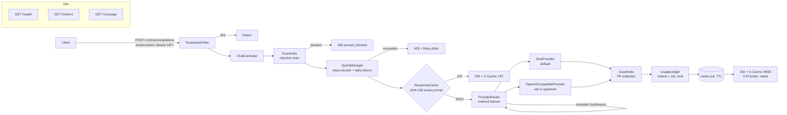

# ai-gateway

An OpenAI-compatible AI gateway in Java 21 + Spring Boot: per-tenant API keys and quotas, exact-prompt response caching, input/output guardrails, provider failover with a circuit breaker, and per-tenant token/cost accounting. The canonical "AI platform backend" portfolio piece — everything an LLM API platform team operates, in one whiteboardable service.

## Architecture



### Request pipeline (in order)

1. **Auth** — `Authorization: Bearer <tenant-key>`; `/health` is public, everything else 401s without a key.
2. **Inbound guardrail** — prompt-injection heuristics scan user messages; blocked → `400 prompt_blocked` (configurable via `gateway.block-on-injection`).
3. **Request quota** — per-tenant token bucket (requests/min); exceeded → `429` with `Retry-After`.
4. **Cache** — SHA-256 over (model + messages); hit → `200` with `X-Cache: HIT` (no upstream call, no cost).
5. **Token quota** — estimated prompt tokens reserved against the tenant's daily cap → `429` if exceeded.
6. **Provider failover** — ordered providers; per provider up to 2 attempts with exponential backoff + jitter; retryable failures (5xx/timeout/IO) fail over, 4xx fails fast; circuit-breaker-lite opens a provider after N consecutive failures.
7. **Outbound guardrail** — PII redaction on the model output (email, phone, SSN, Luhn-verified cards, AWS keys).
8. **Accounting** — quota reconciled with real usage; per-tenant/per-model tokens + estimated cost recorded; response cached.

## Quick start

```bash
# needs JDK 21 + Maven (network for first build)
mvn -B verify
mvn spring-boot:run
```

Try it (default config ships a `demo` tenant and a local stub provider — no API key needed):

```bash
curl -s localhost:8080/health

curl -s -X POST localhost:8080/v1/chat/completions \
  -H "Authorization: Bearer demo-key-123" \
  -H "Content-Type: application/json" \
  -d '{"model":"stub-model","messages":[{"role":"user","content":"Explain Raft in one sentence"}]}' | python3 -m json.tool

# second identical call -> X-Cache: HIT
curl -s -D - -o /dev/null -X POST localhost:8080/v1/chat/completions \
  -H "Authorization: Bearer demo-key-123" \
  -H "Content-Type: application/json" \
  -d '{"model":"stub-model","messages":[{"role":"user","content":"Explain Raft in one sentence"}]}' | grep -i x-cache

curl -s -H "Authorization: Bearer demo-key-123" localhost:8080/v1/usage | python3 -m json.tool
curl -s -H "Authorization: Bearer demo-key-123" localhost:8080/metrics | python3 -m json.tool
```

### Point it at a real upstream

```yaml
gateway:
  providers:
    - name: primary
      type: openai
      base-url: ${UPSTREAM_BASE_URL}      # e.g. https://api.openai.com
      api-key: ${UPSTREAM_API_KEY}        # never commit a real key
      model: gpt-4o-mini
      cost-per-1k-prompt-tokens: 0.00015
      cost-per-1k-completion-tokens: 0.0006
    - name: fallback
      type: openai
      base-url: ${UPSTREAM_FALLBACK_BASE_URL}
      api-key: ${UPSTREAM_FALLBACK_API_KEY}
      model: gpt-4o-mini
```

The router tries providers top-down and fails over on retryable errors, so a
primary + fallback pair is the standard production shape.

## Config reference (`gateway.*` in `application.yml`)

| Key | Default | Meaning |
|---|---|---|
| `cache-ttl-seconds` | 300 | Exact-prompt response cache TTL |
| `block-on-injection` | true | Reject prompts tripping injection heuristics (400) |
| `circuit-breaker-failure-threshold` | 5 | Consecutive failures before a provider's circuit opens |
| `circuit-breaker-cooldown-seconds` | 60 | Cooldown before a half-open trial request |
| `tenants[].name` / `api-key` | — | Tenant identity and Bearer key |
| `tenants[].requests-per-minute` | 60 | Token-bucket request quota |
| `tenants[].tokens-per-day` | 100000 | Daily estimated-token quota (UTC) |
| `providers[].type` | `stub` | `stub` (local, deterministic) or `openai` (any OpenAI-compatible HTTP API) |
| `providers[].cost-per-1k-*-tokens` | 0 | Used for the estimated-cost ledger |

## API

| Method & path | Auth | Description |
|---|---|---|
| `POST /v1/chat/completions` | Bearer key | OpenAI-compatible chat completion |
| `GET /v1/usage` | Bearer key | Per-model token counts + estimated cost for the calling tenant |
| `GET /metrics` | Bearer key | Counters: requests, cache hit rate, 429s, upstream errors/latency, guardrail blocks |
| `GET /health` | none | `{"status":"UP"}` |

Errors follow the OpenAI shape: `{"error":{"message","type","code"}}`.
Quota exhaustion returns `429` with a `Retry-After` header (seconds).

## Trade-offs

- **In-memory cache → Redis/Valkey.** Exact-prompt caching is per-instance today; a shared cache needs Redis plus a canonical key scheme. Deliberately exact-match rather than semantic: cheaper, predictable, no embedding dependency.
- **Heuristic token counting → real tokenizer.** `chars/4` estimates keep quotas working without tiktoken; upstream-reported usage is preferred whenever available. Estimates can under/over-count by ~2x on code or non-English text.
- **Heuristic guardrails → real guardrail service.** Regex + rule-list detection is fast and dependency-free but catches known patterns only — it is not a safety proof. The PII redactor never echoes raw findings.
- **Single instance → distributed quotas.** Token buckets, daily counters, circuits, and the usage ledger are in-process. Multi-instance needs Redis-backed buckets and a shared ledger.
- **Blocking servlet → WebFlux.** Upstream calls block a Tomcat thread; fine at this scale, but high-concurrency gateways want non-blocking IO.
- **Config-file tenants → control plane.** Tenants live in `application.yml` for clarity; production needs a tenant service with key rotation and secret-manager-backed credentials.

## Limitations (honest)

- No streaming (`stream: true` → `400 streaming_unsupported`); no embeddings, vision, or function-calling passthrough — chat completions only.
- The default provider is a deterministic stub: it echoes, it does not reason. Real intelligence requires configuring an upstream.
- Token counts and costs are estimates unless the upstream reports usage.
- p50/p95 latency is not tracked (avg + max only); that is Micrometer/Prometheus's job.
- Half-open circuit allows exactly one trial; there is no bulkhead or concurrency limit per provider.
- Guardrails are heuristics: adversarial prompts and novel PII formats will slip through — documented, not hidden.

## Tests

`mvn -B verify` — unit tests only, no network, no Spring context:

- `TokenBucket` / `QuotaManager`: capacity, refill, daily-token reserve/reconcile
- `ResponseCache`: hit/miss, TTL expiry, key stability
- `Guardrails`: injection rules, PII redaction incl. Luhn-verified cards
- `ProviderRouter`: retry-then-failover, 4xx fast-fail, all-failed → 502 path, circuit opens and skips
- `StubProvider`: deterministic echo
- `TenantAuthFilter`: public `/health`, 401 on bad key, tenant attribute on good key

## License

MIT — see [LICENSE](LICENSE).
